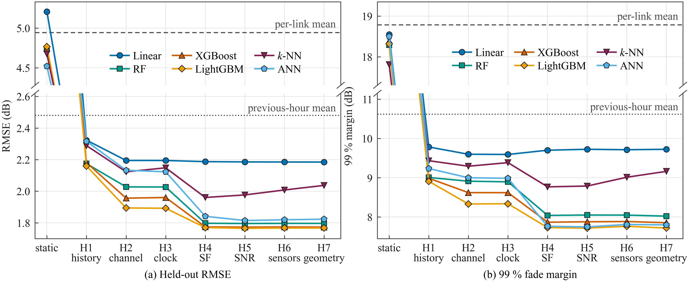

# Indoor LoRaWAN path loss modeling

Fade margins for indoor LoRaWAN links as a function of what the predictor knows: propagation models, machine learning regressors and the link's own earlier packets, evaluated on a later period, with the margins calibrated and tested as quantile forecasts.

[](https://doi.org/10.5281/zenodo.15349730)
[](https://doi.org/10.1109/ACCESS.2025.3569164)
[](https://www.python.org/)
[](LICENSE)

One year of measurements from six fixed links on one office floor: 2,660,274 uplinks, spreading factors 7 to 12, five environmental sensors at each device. Five propagation models and six machine learning families are fitted on static inputs, then on cumulative rungs of link history. One chronological protocol throughout: the earliest 80 % of the packets train, five forward-chaining folds select, the latest 20 % are held out and used once. A fade margin is the empirical quantile of the out-of-fold residuals at the split-conformal level (`margin_tools.py`), scored on the hold-out by coverage within operating states, pinball loss and the clustering of the misses. The same procedure runs on two public datasets, the Medellín measurements of González-Palacio et al. and the campus metadata of the University of Virginia.



*Hold-out RMSE (a) and 99 % margin (b) of the six families on the static inputs and on the rungs H1 to H7; dashed, the per-link mean; dotted, the previous-hour mean.*

## Data

Download file 3 of version 4 of the Zenodo record and check it:

```bash
mkdir -p Data_Files
curl -L https://zenodo.org/api/records/23496955/files/3.cleaned_dataset_per_device.csv/content -o Data_Files/cleaned_dataset_per_device.csv
printf '%s  %s\n' 638d918ffc3a15bb10564c852df6e6b0 Data_Files/cleaned_dataset_per_device.csv | md5sum --check
```

The file has 2,660,274 rows with the RSSI and SNR of the project gateway, pressure in hPa, the transmit power the network server set for each uplink (`tx_power`) and the path loss computed from it (`exp_pl`); the [data pipeline](https://github.com/nahshonmokua/LoRaWAN-Indoor-PathLoss-Dataset-IEEEACCESS) regenerates it from the raw export. Notebook 19 reads `LoRaWAN_PathLossMeasurements.csv` from [magonzalezudem/MDPI_LoRaWAN_Dataset_With_Environmental_Variables](https://github.com/magonzalezudem/MDPI_LoRaWAN_Dataset_With_Environmental_Variables), placed in `Data_Files/`; notebook 21 reads `lorawan_combined_dataset.parquet` and `deployment_weather.parquet` from the [Dataverse record](https://doi.org/10.18130/V3/RFTICK), placed in `Data_Files/uva_lorawan/`.

## Environments

Python 3.12. The main environment from [`requirements.txt`](requirements.txt), kernel `lorawan-pathloss`; notebooks 06 and 14 need the RAPIDS environment from [`requirements-rapids-cu12.txt`](requirements-rapids-cu12.txt), kernel `lorawan-pathloss-rapids`:

```bash
python3.12 -m venv .venv && source .venv/bin/activate
python -m pip install -r requirements.txt
python -m ipykernel install --user --name lorawan-pathloss --display-name "Python (LoRaWAN path loss)"
```

```bash
python3.12 -m venv .venv-rapids && source .venv-rapids/bin/activate
python -m pip install -r requirements-rapids-cu12.txt
python -m ipykernel install --user --name lorawan-pathloss-rapids --display-name "Python (LoRaWAN path loss, RAPIDS)"
```

## Pipeline

The notebooks are numbered in run order and run from the repository root; each opens with a cell that states what it does and what it writes. Outputs go to `Data_Files/`, `Models/`, `Residuals/`, `CV_Results/`, `Shadow_Results/`, `FM_Results/`, `Figures/` and `Tables/`, which are not versioned; the executed cells show the reported runs.

| Stage | Notebooks | Writes |
|---|---|---|
| Chronological split and forward-chaining folds | 00 | `Data_Files/train.csv`, `test.csv`, fold indices |
| Static models: five propagation models, Lasso, random forest, XGBoost, LightGBM, k-NN (RAPIDS), ANN | 01 to 07 | `Models/`, `Residuals/`, `CV_Results/` |
| Residual distribution and fade margins | 08, 09 | `Shadow_Results/`, `FM_Results/` |
| Comparisons of the static models: searches, paired bootstrap, input groups, error metrics | 10, 11, 18, 20 | `CV_Results/`, `Figures/` |
| Link history: the inputs and rungs H1 to H7, every family, a link left out, re-tuning | 12, 13, 14 (RAPIDS), 15, 23 | `Data_Files/history_*.csv`, `CV_Results/history_*.csv`, `information_by_family.csv` |
| Margin calibration on rolling windows; the estimators of adaptive data rate schemes | 16, 17 | `CV_Results/margin_*.csv`, `adr_estimators.csv` |
| The same ladder on the two public datasets | 19, 21 | `CV_Results/medellin_*.csv`, `uva_*.csv` |
| Tables and figures | 22 | `Tables/`, `Figures/` |

Shared code: `history_features.py` (the history inputs and the rungs), `margin_tools.py` (the calibrations), `residual_distribution.py` (mixtures with the number of components by cross-validation), `paper_figures.py` (the figure style).

Wall-clock on 32 cores, 60 GB of RAM and one RTX 5090: 03 about 5 h, 06 21.5 h, 07 3.3 h, 09 3.5 h, 13 6.4 h, 15 71 min; the other notebooks take minutes.

## Results

Hold-out window 21 July to 30 September 2025, 532,055 packets; RMSE and the 99 % margin in dB.

| Model | Inputs | Held-out RMSE | 99 % margin | Source |
|---|---|---|---|---|
| Per-link mean | none | 4.94 | 18.2 | `CV_Results/static_feature_groups.csv` |
| COST 231 multi-wall, calibrated | geometry, channel | 6.37 | 18.3 | `Residuals/residuals_PLM_COST231_MWM_*.csv` |
| Lasso | geometry, channel, sensors | 5.21 | 18.5 | `Residuals/residuals_MLR_*.csv` |
| Random forest | geometry, channel, sensors | 4.74 | 18.3 | `Residuals/residuals_RF_*.csv` |
| XGBoost | geometry, channel, sensors | 4.74 | 18.4 | `Residuals/residuals_XGB_*.csv` |
| LightGBM | geometry, channel, sensors | 4.77 | 18.3 | `Residuals/residuals_LGBM_*.csv` |
| k-nearest neighbours | geometry, channel, sensors | 4.68 | 17.8 | `Residuals/residuals_KNN_*.csv` |
| ANN | geometry, channel, sensors | 4.52 | 18.5 | `Residuals/residuals_ANN_*.csv` |
| Previous-hour mean | the link's earlier packets | 2.48 | 10.6 | `CV_Results/history_benchmark.csv` |
| LightGBM, rung H1 | link history | 2.16 | 8.9 | `CV_Results/information_by_family.csv` |
| LightGBM, rung H4 | + same-channel history, clock, spreading factor | 1.77 | 7.7 | `CV_Results/information_by_family.csv` |
| LightGBM, rung H7 | + earlier SNR, sensors, link level, geometry | 1.77 | 7.7 | `CV_Results/information_by_family.csv` |

Every family on every rung is in `CV_Results/information_by_family.csv`; the paired intervals of the static models in `CV_Results/bootstrap_test_comparison.csv`; the margins by operating state and the estimators of adaptive data rate schemes in the result files of notebooks 16 and 17; the input groups with intervals in `CV_Results/static_feature_groups.csv` and `history_group_steps.csv`; the public datasets in `CV_Results/medellin_ladder.csv` and `uva_ladder.csv`.

## Citation

If you use the measurements, cite the data paper:

> N. Mokua Obiri and K. van Laerhoven, “A Comprehensive Data Description for LoRaWAN Path Loss Measurements in an Indoor Office Setting: Effects of Environmental Factors,” *IEEE Access*, vol. 13, pp. 83148–83170, 2025. https://doi.org/10.1109/ACCESS.2025.3569164

To cite the code, use [`CITATION.cff`](CITATION.cff), which GitHub offers as “Cite this repository”. The dataset is CC BY 4.0; the code is under the [MIT licence](LICENSE).
