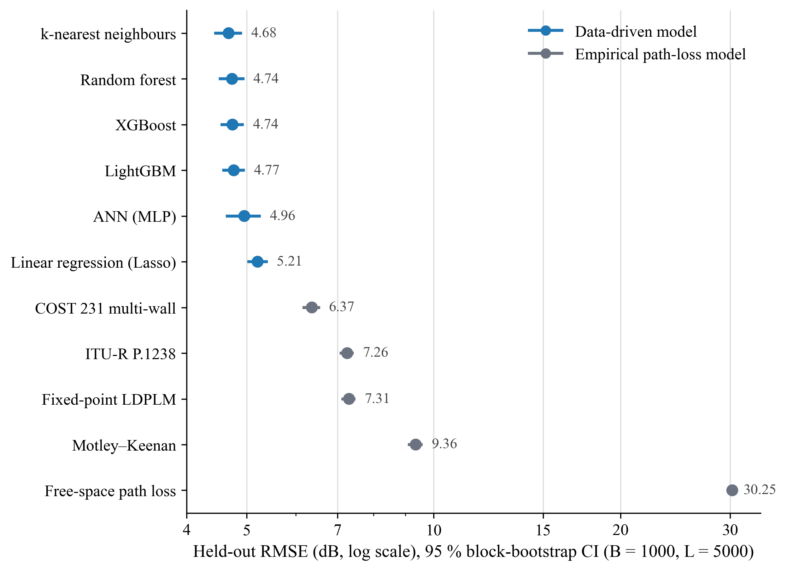
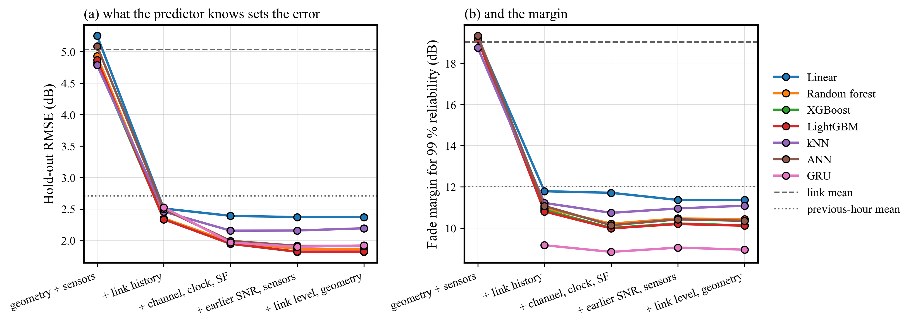
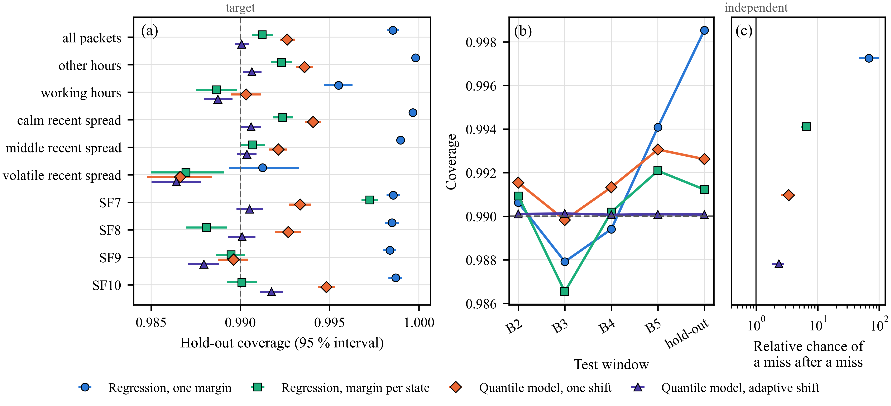
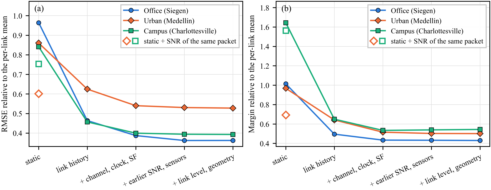

# Indoor LoRaWAN path loss modeling

**Temporally separated evaluation of analytical and empirical propagation models and machine learning regressors, with residual-tail calibration of fade margins as a function of what the predictor knows.**

[](https://doi.org/10.5281/zenodo.15349730)
[](https://doi.org/10.1109/ACCESS.2025.3569164)
[](https://www.python.org/)

## Aim

This study compares analytical and empirical indoor propagation laws, linear models, tree ensembles, nearest-neighbour regression and neural networks on a later period of LoRaWAN path loss measurements. It then uses out-of-fold errors to estimate fade margins at specified residual-coverage targets, and asks how those margins depend on what the predictor knows: geometry and environmental sensors only, or also the link's own earlier packets.

RMSE and the upper residual tail are distinct objectives. With geometry and sensors alone the 99% fade margin is 17.8 to 18.5 dB for every ML model and the calibrated COST 231 multi-wall model, although held-out RMSE ranges from 4.5 to 6.4 dB. With the link's earlier packets it falls to 7.7 to 9.8 dB when calibrated on the whole year, which includes SF11 and SF12 rows that the hold-out lacks. A margin that also conditions on the spreading factor and the state of the link needs about 4 dB on the hold-out. Notebooks 16 to 21 test the margins as quantile forecasts, compare the history models with the estimators of adaptive data rate schemes, measure what each group of inputs adds, repeat the ladder on two public datasets, and report the mean absolute error and the correlation within each link.

## Experimental design

The analysis uses 2,660,274 timestamped observations from six fixed indoor links collected from 1 October 2024 to 30 September 2025 in an office environment at the University of Siegen, at spreading factors 7 to 12. The static predictors are distance, carrier frequency, concrete- and wood-wall counts, CO₂, relative humidity, PM2.5, pressure and temperature; the response is path loss derived from the received signal strength at the project gateway. The SNR of the packet being predicted is not a predictor. The history rungs described below add inputs computed from the link's earlier packets only.

The evaluation protocol is deliberately chronological:

1. The earliest 80% of observations form the training period; the latest 20% are held out.
2. Hyperparameters are selected only within the training period, using five forward-chaining folds: each validation block is predicted by models trained on the blocks before it.
3. Out-of-fold residuals from those folds are used for residual-tail modelling and fade-margin calibration.
4. The untouched later period is used for final error and residual-coverage assessment.

This gives 2,128,219 training observations (1 October 2024 to 21 July 2025) and 532,055 test observations (21 July to 30 September 2025). The first block of 354,704 rows is only ever training data; the five following blocks of 354,703 rows give 1,773,515 out-of-fold residuals per model. Where scaling is used, it is fitted within each fold.

The end devices were restricted to spreading factors 7 to 10 in July 2025. The hold-out therefore contains SF11 or SF12 in only 33 of its rows, against 17 to 28% of the rows in the validation blocks, and margins calibrated on the validation blocks are conservative on it. The hold-out tests temporal transfer within the same building and six links; an unseen-link test fits on five links and predicts the sixth. Neither is evidence of generalisation to other buildings or link geometries.

Early stopping uses the latest part of each training set in time order: for the ANN of notebook `07`, the latest tenth of the training rows within each fold and the latest training block in the final fit; the latest 10% of the rows for the ANN of the history notebooks. The ANN of notebook `07` seeds Keras directly (`keras.utils.set_random_seed`; under Keras 3, `tf.random.set_seed` leaves the initial weights, dropout and shuffling unseeded) and standardises its target inside each fit, so that two runs of the notebook give identical files; the static ANN of notebook `15` uses the same recipe.

## Main results

### Static models



*Held-out path loss error on the 532,055 rows common to all models. Points are RMSE; bars are 95% circular moving-block-bootstrap intervals (1,000 replicates; block length 5,000). Intervals quantify test-sampling uncertainty with fitted models held fixed.*

| Model | Out-of-fold RMSE | Held-out RMSE | Held-out R² | 95% margin | 99% margin |
|---|---|---|---|---|---|
| COST 231 multi-wall (calibrated) | 7.21 | 6.37 | 0.847 | 11.5 | 18.3 |
| Linear regression (Lasso) | 6.49 | 5.21 | 0.898 | 11.2 | 18.5 |
| Random forest | 6.26 | 4.74 | 0.915 | 11.2 | 18.3 |
| XGBoost | 6.26 | 4.74 | 0.915 | 10.8 | 18.4 |
| LightGBM | 6.25 | 4.77 | 0.914 | 10.8 | 18.3 |
| k-nearest neighbours | 6.36 | 4.68 | 0.917 | 10.8 | 17.8 |
| ANN (MLP) | 6.86 | 4.52 | 0.923 | 11.6 | 18.5 |

*RMSE in dB. Out-of-fold RMSE pools the 1,773,515 validation rows; R² is computed from the held-out residual files; margins in dB at the 95% and 99% residual-coverage targets.*

The ANN leads at 4.52 dB (95% CI 4.28 to 4.75), resolved ahead of kNN at 4.68 dB by 0.16 dB (CI 0.04 to 0.26) and of the three tree ensembles by 0.22 to 0.25 dB; kNN is resolved ahead of the random forest at 4.74 dB by 0.06 dB (CI 0.00 to 0.12) but not of XGBoost at 4.74 and LightGBM at 4.77 dB (0.07 and 0.09 dB, with intervals that include zero). The five nonlinear models are resolved ahead of the linear model, by 0.44 to 0.69 dB. The ANN's one-standard-error selection, among candidates that differ by tenths of a decibel of validation RMSE, chose a 16/8/4 network with dropout 0.1 (421 parameters), whose 30-seed ensemble reaches 4.52 dB (single seeds 4.50 to 5.30 dB). The kNN's $k$ was searched from 100 to 50,000 together with the metric, the weighting and the scaling; the selected $k$ = 30,780 (Manhattan distance, distance weights) lies inside that range; it is 1.4% of the training rows, about 9% of the packets of one link, so the prediction is a heavily smoothed average. Every ML model beats the calibrated COST 231 multi-wall model by 1.2 to 1.8 dB and the fixed-parameter propagation models by at least 2.0 dB.

At a 99% residual-coverage target the static ML models and COST 231 need 17.8 to 18.5 dB, at 98% 14.8 to 15.5 dB and at 95% 10.8 to 11.6 dB; the other propagation models need more. The six ML models lie within 0.7 dB of each other at 99%. Every margin in this repository is the empirical quantile of the out-of-fold residuals, the split-conformal shift of `margin_tools.py`; a Gaussian-mixture tail estimate, with the number of components chosen by cross-validation over the time blocks, is reported next to it as a sensitivity check and lies within 0.5 dB of it at 99% for the static models and within 0.05 dB for every family on history rung H4 (notebook 09). Held-out coverage at the 99% margin is 99.7 to 99.8%, and a fixed 10 dB margin reaches 97.4 to 98.3%. Intervals come from a device-aware moving-block bootstrap.

### Link history



*Hold-out RMSE (a) and calibrated 99% fade margin (b) by information rung and model family; each y-axis is broken between the static models and rung H1. Dashed: the per-link mean; dotted: the previous-hour mean.*

From here the response is the deviation of path loss from the link's previous-hour mean, so the inputs are level-free and a model that predicts no deviation scores as the previous-hour mean. The rungs are cumulative: H1 holds the link's earlier path loss as lags and windows from five packets to seven days; H2, H3 and H4 add the history of the same channel, the clock and the spreading factor; H5 and H6 the SNR of earlier packets and the environmental sensors; H7 the link's level and its geometry. Every feature of a packet uses earlier packets of the same link only.

| Family | Static | H1: link history | H2: + channel history | H3: + clock | H4: + SF | H5: + earlier SNR | H6: + sensors | H7: + level, geometry |
|---|---|---|---|---|---|---|---|---|
| Linear regression | 5.21 / 18.5 | 2.32 / 9.8 | 2.19 / 9.6 | 2.19 / 9.6 | 2.19 / 9.7 | 2.19 / 9.7 | 2.18 / 9.7 | 2.18 / 9.7 |
| Random forest | 4.74 / 18.3 | 2.17 / 9.0 | 2.03 / 8.9 | 2.03 / 8.9 | 1.80 / 8.0 | 1.80 / 8.1 | 1.80 / 8.0 | 1.80 / 8.0 |
| XGBoost | 4.74 / 18.4 | 2.18 / 9.0 | 1.96 / 8.6 | 1.96 / 8.6 | 1.77 / 7.9 | 1.77 / 7.9 | 1.77 / 7.9 | 1.77 / 7.9 |
| LightGBM | 4.77 / 18.3 | 2.16 / 8.9 | 1.89 / 8.3 | 1.89 / 8.3 | 1.77 / 7.7 | 1.77 / 7.7 | 1.77 / 7.8 | 1.77 / 7.7 |
| k-nearest neighbours | 4.68 / 17.8 | 2.29 / 9.4 | 2.12 / 9.3 | 2.15 / 9.4 | 1.96 / 8.8 | 1.98 / 8.8 | 2.01 / 9.0 | 2.04 / 9.2 |
| ANN (MLP) | 4.52 / 18.5 | 2.32 / 9.2 | 2.13 / 9.0 | 2.12 / 9.0 | 1.84 / 7.8 | 1.81 / 7.7 | 1.82 / 7.8 | 1.82 / 7.8 |

*Hold-out RMSE / 99% fade margin, both in dB; the rungs are cumulative from left to right. The static column is the model of the table above. Without a fitted model: link mean 4.94 dB / 18.8 dB; previous-hour mean 2.48 dB / 10.6 dB; previous packet 2.96 dB / 12.0 dB.*

Adding the link's earlier packets halves RMSE and brings the 99% margin from 17.8 to 18.5 dB to between 8.9 and 9.8 dB in every family. The later rungs lower RMSE further, to 1.8 dB for the boosted trees, and the margin by up to 1.5 dB more (the boosted trees reach 7.7 to 7.9 dB), in the tree ensembles and the ANN almost entirely through the same-channel history and the spreading factor. At the last rung the boosted trees, the random forest and the ANN end between 1.77 and 1.82 dB; kNN and the linear model are 0.2 to 0.4 dB behind.

Fitted on five links and tested on the sixth (rung H4), against the same model fitted on the same blocks with the link included, the tree ensembles reach 1.84 to 1.86 dB on the unseen link, at most 0.01 dB above the model that saw the link; the ANN reaches 1.87 dB, kNN 2.07 dB and the linear model 2.19 dB, and the largest penalty in any family is 0.02 dB (the ANN). Coverage at the calibrated 99% margin is 99.4 to 99.9% per unseen link. The static models do not transfer: fitted on five links with the settings of the table above, they reach 6.4 to 11.0 dB on the sixth as a mean over the six links, against 4.5 to 5.1 dB with the link in training (`CV_Results/unseen_link_static.csv`), the tree ensembles missing ED5, which lies beyond the 37 m of the other links, by 10 to 20 dB. The history model needs one other link: fitted on one other link, LightGBM on rung H4 predicts the held-out link at 1.89 dB on average, fitted on five at 1.84 dB, and with the link itself in training at 1.84 dB, against 2.47 dB for the anchor alone (`CV_Results/links_curve_H4.csv`).

### Mean absolute error and correlation

Notebook 20 adds the mean absolute error and the Pearson correlation between measurement and prediction, on the 531,983 hold-out packets that every model predicts, with 95% intervals from resampling days. The correlation is given twice: over all links, and within each link, after removing the mean of the link from the measurement and from the prediction, which measures whether a model follows the variation of a link in time.

| Model | MAE | RMSE | Bias | R² | r, all links | r, within link |
|---|---|---|---|---|---|---|
| COST 231 multi-wall (calibrated) | 5.05 [4.81, 5.31] | 6.37 | +1.56 | 0.847 | 0.926 [0.919, 0.932] | -0.11 [-0.12, -0.09] |
| Linear regression (Lasso) | 4.10 [3.93, 4.29] | 5.21 | +1.53 | 0.898 | 0.953 [0.947, 0.958] | -0.09 [-0.17, -0.02] |
| Random forest | 3.69 [3.50, 3.89] | 4.74 | +1.10 | 0.915 | 0.961 [0.955, 0.966] | +0.01 [-0.05, +0.07] |
| XGBoost | 3.74 [3.56, 3.93] | 4.74 | +1.36 | 0.915 | 0.961 [0.955, 0.966] | +0.11 [+0.09, +0.13] |
| LightGBM | 3.77 [3.59, 3.96] | 4.77 | +1.45 | 0.914 | 0.961 [0.955, 0.966] | +0.12 [+0.10, +0.14] |
| k-nearest neighbours | 3.61 [3.40, 3.82] | 4.68 | +0.91 | 0.917 | 0.963 [0.958, 0.969] | +0.05 [-0.02, +0.12] |
| ANN (MLP) | 3.50 [3.31, 3.70] | 4.52 | +0.52 | 0.923 | 0.961 [0.955, 0.967] | -0.09 [-0.16, -0.01] |
| Link mean (no model) | 3.94 [3.76, 4.13] | 4.94 | +1.55 | 0.908 | 0.959 [0.954, 0.964] | constant per link |
| Previous-hour mean (no model) | 1.84 [1.80, 1.87] | 2.48 | +0.00 | 0.977 | 0.988 [0.987, 0.989] | +0.81 [+0.78, +0.83] |
| LightGBM + link history | 1.60 [1.58, 1.63] | 2.16 | +0.02 | 0.982 | 0.991 [0.990, 0.992] | +0.86 [+0.84, +0.88] |
| LightGBM + channel, clock, SF | 1.27 [1.25, 1.30] | 1.77 | +0.01 | 0.988 | 0.994 [0.993, 0.995] | +0.91 [+0.89, +0.92] |
| LightGBM + link level, geometry | 1.27 [1.25, 1.29] | 1.77 | +0.02 | 0.988 | 0.994 [0.993, 0.995] | +0.91 [+0.89, +0.92] |

*MAE, RMSE and bias in dB; r is the Pearson correlation between measured and predicted path loss. The first seven rows use geometry and sensors only; the last three use the rungs of the table above.*

- **Over all links the correlation mostly identifies the link.** The mean path loss of the links spans 43 dB (66 dB for ED0, 109 dB for ED5) and 93% of the variance of the path loss on the hold-out lies between the links, so one constant per link scores 0.959 and every static ML model between 0.953 and 0.963. COST 231 scores 0.926, the models with link history 0.990 to 0.994.
- **Within a link no static model follows the path loss in time.** Their correlation lies between -0.11 and +0.12, the previous-hour mean alone reaches 0.81 and the models with link history 0.83 to 0.91. The -0.11 of the physical models is the channel: the carrier frequency is their only input that changes within a link, a term of 0.005 dB, and a correlation does not depend on scale, so it equals the correlation of the measured path loss with the frequency.
- **The MAE orders the static models like the RMSE.** ANN, kNN, random forest, XGBoost, LightGBM, link mean and linear model stand in the same order by both measures. The static ML models reach 3.50 dB (ANN) to 4.10 dB (linear), COST 231 5.05 dB and the models with link history 1.3 to 1.7 dB. The fitted static models and the link mean are biased by +0.5 to +1.6 dB on the summer hold-out, the models with link history by at most 0.25 dB.

### Calibrating and validating the margins

A margin is an upper quantile forecast, so it is tested like one. The shift added to a base predictor comes only from earlier packets, the score is the pinball loss, coverage is checked by state and not only overall, and the misses are tested for independence. Notebook 16 builds the margin on rung H4 with a LightGBM regression and with LightGBM quantile models, calibrates it five ways, and tests each on five windows: validation folds 1 to 4 and the hold-out, each calibrated on the folds before it. Hold-out, 99% target:

| Margin | Coverage | Lowest state coverage | Mean margin, dB | Pinball loss x 1000 | Miss clustering |
|---|---|---|---|---|---|
| Regression, one margin | 99.85% | 99.12% | 7.74 | 85.7 | 68.2 |
| Regression, margin per spreading factor and hours | 99.33% | 97.68% | 4.64 | 61.4 | 12.0 |
| Regression, margin per state, 36 cells | 99.12% | 98.69% | 4.20 | 58.3 | 6.5 |
| Regression, adaptive margin | 99.05% | 97.40% | 4.32 | 63.1 | 9.9 |
| Quantile model, one shift | 99.26% | 98.66% | 3.98 | 52.0 | 3.4 |
| Quantile model, shift per state | 99.11% | 98.79% | 3.90 | 51.6 | 2.7 |
| Quantile model, adaptive shift | 99.01% | 98.64% | 3.78 | 51.3 | 2.4 |

*Coverage is the share of hold-out packets below the margin. The lowest state coverage is over the working and other hours, the recent-spread terciles, the spreading factors and the links with 1,000 packets or more. Miss clustering is the chance of a miss right after a miss divided by the chance after a covered packet; 1 means independent misses. The margin per state is a lookup table of 36 shifts by spreading factor, working hours and recent-spread tercile.*



*Coverage (top) and mean margin above the anchor (bottom) of four margins at the 99% target: by working hours (a), recent spread (b) and spreading factor (c) on the hold-out, with 95% intervals from resampling days, and in each test window, calibrated on the blocks before it (d).*

- **A single pooled shift drifts with the regime.** One margin from all earlier validation packets covers between 98.8 and 99.4% in the four validation windows and 99.85% on the hold-out, which holds practically no SF11 or SF12 (33 packets) and is a summer window. In the validation windows its worst state is always SF12, covered at 93.6 to 94.6%, while SF7 to SF11 are covered at 99.5 to 99.9%.
- **Knowing the state is most of the gain.** A margin per group of spreading factor and working hours cuts the pinball loss from 85.7 to 61.4 per thousand, and the table of 36 margins to 58.3. The mean margin above the anchor falls from 7.7 to 4.6 dB with the margin per spreading factor and hours and to 4.2 dB with the 36-cell table, at a hold-out coverage of 99.33 and 99.12% instead of 99.85%.
- **The quantile model is sharper than the table by about 11%.** Its pinball loss is 6.3 per thousand lower than that of the 36-cell table, with a 95% interval from 5.0 to 8.2. Its coverage in the volatile third is level with the table (difference -0.03 points, interval -0.20 to +0.13) and 1.0 point above the 12-cell table (interval +0.7 to +1.2). Conditional coverage therefore comes from knowing the state, by a table or by a model.
- **Adaptive conformal inference holds the target in every window.** Coverage is 99.0 to 99.1% in all five windows for both base predictors, where the pooled shift moves between 98.8 and 99.85%. In validation fold 3, the window with the heaviest tail, it lowers the pinball loss of the quantile model by 33%, with an interval from 8% to 69%.
- **Misses cluster less the more the margin knows.** The ratio is 68 for one regression margin and 2.4 for the quantile model with the adaptive shift, with an interval from 1.8 to 2.9, so no method reaches independence. A regression of the misses on the previous miss and the state rejects independence for every method with half a million packets, so the effect size matters: the chance of a miss across the states ranges from 0 to 14% with one regression margin and from 0.7 to 3.7% with the adaptive quantile margin, against a target of 1%.
- **The other targets.** At the 95 and 90% targets the ordering is the same. The adaptive quantile model reaches 95.0 and 90.0% coverage on the hold-out with a mean margin of 2.4 and 1.9 dB, where one regression margin gives 97.6 and 92.6% with 3.1 and 2.1 dB.

At one uplink every 10 minutes LightGBM on rung H4 reaches 2.1 dB RMSE and a 99% margin of 10.3 dB, against 2.5 dB and 11.9 dB for the mean of the previous 20 packets; at one uplink per hour it reaches 2.4 dB and 11.8 dB, against 3.1 dB and 13.2 dB for the 20-packet mean and 2.9 dB and 12.0 dB for the previous packet.

### Estimators from the adaptive data rate literature

Notebook 17 puts the estimators of adaptive data rate schemes on the same footing as the ML history models: the previous packet, the mean, the median, the exponential average, a Kalman filter and the linear-regression extrapolation of the last 20 packets, and the best of the last 20 packets that the standard rule uses. The tuned ones are tuned on the validation folds. The margin is one shift per group of spreading factor and working hours, calibrated on the validation folds. Hold-out, 99% target, with the difference to the LightGBM in pinball loss and its 95% interval:

| Estimator of the current path loss | RMSE, dB | Coverage | Mean margin, dB | Pinball loss x 1000 | Difference to LightGBM |
|---|---|---|---|---|---|
| LightGBM on rung H4 | 1.77 | 99.3% | 4.64 | 61.4 |  |
| exponential average, weight 0.05 | 2.41 | 99.4% | 5.32 | 68.5 | +7.14 [+6.42, +7.92] |
| Kalman filter, drift 0.01 | 2.40 | 99.4% | 5.23 | 67.0 | +5.64 [+5.11, +6.22] |
| mean of the last 20 | 2.39 | 99.4% | 5.39 | 68.2 | +6.85 [+6.30, +7.45] |
| median of the last 20 | 2.44 | 99.5% | 5.77 | 71.3 | +9.96 [+9.34, +10.69] |
| previous hour mean | 2.48 | 99.3% | 5.52 | 72.0 | +10.67 [+9.27, +12.17] |
| linear regression over the last 20 | 2.74 | 99.3% | 5.72 | 71.7 | +10.38 [+9.60, +11.22] |
| previous packet | 2.96 | 99.2% | 6.72 | 83.6 | +22.19 [+21.04, +23.42] |
| 24 hour mean | 3.12 | 99.3% | 8.51 | 108.9 | +47.55 [+39.03, +58.18] |
| best of the last 20 | 4.70 | 99.7% | 9.41 | 105.3 | +43.99 [+42.88, +45.10] |

- **LightGBM on rung H4 beats every classical estimator.** The exponential average and the Kalman filter reach 2.41 and 2.40 dB, level with the mean of the last 20 packets, 2.39 dB, and close to the previous-hour mean, 2.48 dB. LightGBM reaches 1.77 dB. Filtering is not what matters: LightGBM gains from the longer windows, the same-channel history and the spreading factor, which the classical estimators do not use.
- **The standard rule is the weakest.** The best of the last 20 packets selects the extreme and estimates the level with a 4.70 dB RMSE. A fixed 10 dB above it, 6.2 dB above the anchor on average, covers 97.7% at a 99% target; the same 10 dB above the mean of the last 20 packets covers 99.9%.

### What each group of inputs adds

Notebook 18 repeats the static benchmark with one LightGBM tuned separately on every subset of the nine inputs, and measures every step of the history rungs with paired intervals from resampling days. The static inputs, hold-out:

| Inputs | Hold-out RMSE, dB | Difference to the per-link mean |
|---|---|---|
| distance only | 4.86 | -0.08 [-0.14, -0.03] |
| geometry | 4.86 | -0.08 [-0.13, -0.03] |
| geometry + channel | 4.85 | -0.10 [-0.11, -0.08] |
| geometry + environment | 4.75 | -0.20 [-0.25, -0.15] |
| geometry + channel + environment (the benchmark) | 4.77 | -0.18 [-0.28, -0.07] |
| benchmark + SNR of the same packet | 4.70 | -0.24 [-0.45, -0.04] |
| environment only | 15.99 | +11.05 [+10.59, +11.49] |
| per-link mean | 4.94 |  |
| global mean | 16.35 | +11.41 [+10.96, +11.84] |

*The difference to the per-link mean is the hold-out RMSE minus that of the mean of each link over the earlier training packets, with a 95% interval. Distance alone takes six values for six links, so it is a per-link constant.*

- **Every subset with the geometry, and without the SNR of the same packet, is within 0.20 dB of the per-link mean.** The whole range is as large as the noise of the tuning: repeating the search and the fits for the same inputs moves the hold-out RMSE by up to 0.07 dB. Distance alone, which is the per-link mean up to shrinkage, lands 0.08 dB below it, so differences of that size are not resolved.
- **The environment adds about 0.1 dB, not resolved from zero.** Added to the geometry it lowers the hold-out RMSE from 4.86 to 4.75 dB; added to geometry and channel, by 0.08 dB, with an interval from -0.19 to +0.03. Both are of the order of the tuning noise. The sensors alone remove 4% of the variance around one mean for all links, where the training mean of each link removes 91%.
- **The SNR of the same packet is worth 0.07 dB here, not resolved from zero.** Added to the benchmark it lowers the hold-out RMSE from 4.77 to 4.70 dB (-0.07 [-0.17, +0.04]) and raises the 99% shift from 18.28 to 18.40 dB. Link by link it ranges from -0.70 dB on ED5, the weakest link, to +0.49 dB on ED1, where the added input makes the model worse; every office link operates at a median SNR of 8.2 to 10.5 dB (`CV_Results/static_snr_leak.csv`). It is known only once the packet has been received, so it cannot enter a link budget; on the public datasets the same leak is worth 0.64 dB (Medellín) and 0.53 dB (campus).
- **The link's history is the step.** It lowers the RMSE by 2.20 to 2.88 dB in every family. Of the groups that follow, the same-channel history changes the hold-out RMSE by -0.27 to -0.13 dB over the families and the spreading factor by -0.28 to -0.01 dB (negative: the added inputs help), while the SNR of earlier packets, the clock, the sensors and the link level with the geometry change it by no more than 0.04 dB in any family (table below).

| Step | Linear regression | Random forest | XGBoost | LightGBM | k-nearest neighbours | ANN (MLP) |
|---|---|---|---|---|---|---|
| static to H1: link history | -2.88 | -2.56 | -2.56 | -2.61 | -2.39 | -2.20 |
| H1 to H2: same-channel history | -0.13 | -0.15 | -0.22 | -0.27 | -0.17 | -0.18 |
| H2 to H3: clock | 0.00 | 0.00 | 0.00 | 0.00 | +0.03 | -0.01 |
| H3 to H4: spreading factor | -0.01 | -0.23 | -0.19 | -0.12 | -0.19 | -0.28 |
| H4 to H5: earlier SNR | 0.00 | 0.00 | 0.00 | 0.00 | +0.02 | -0.03 |
| H5 to H6: sensors | 0.00 | 0.00 | 0.00 | 0.00 | +0.03 | 0.00 |
| H6 to H7: level, geometry | 0.00 | 0.00 | 0.00 | 0.00 | +0.03 | 0.00 |

*Hold-out RMSE of the later rung minus that of the earlier rung, in dB (negative: the added inputs help), on the packets common to all models. The 95% intervals from resampling days have half-widths of 0.21 to 0.28 dB at the first step and at most 0.01 dB afterwards; they exclude zero except for Linear regression, Random forest, XGBoost, LightGBM (H6 to H7: level, geometry). All steps with their intervals are in `CV_Results/history_group_steps.csv`.*

### The same ladder on an independent public dataset

Notebook 19 runs the same procedure on the public urban measurements of González-Palacio et al. ([data descriptor](https://doi.org/10.3390/data8010004)): four fixed end nodes in Medellín, 930,753 uplinks over six months, with the same chronological split and the same rungs, the sensors of that dataset in place of ours. LightGBM, hold-out:

| Inputs | Hold-out RMSE, dB | 99% margin, dB |
|---|---|---|
| per-link mean | 2.47 | 5.7 |
| previous hour mean | 1.62 | 3.9 |
| static inputs | 2.12 | 5.5 |
| static inputs + SNR of the same packet | 1.48 | 4.0 |
| rung H1 | 1.54 | 3.7 |
| rung H4 | 1.33 | 3.0 |
| rung H6 | 1.31 | 2.9 |
| rung H7 | 1.30 | 2.9 |

The figure of the next section draws this ladder next to the office's and the campus data's.

- **The ladder replicates.** The margin falls to 50 to 52% of the per-link mean's margin from rung H4 on, against 41% for the same model in the office, and the later rungs add little.
- **The SNR of the same packet buys what history buys.** Added to the static inputs, with the static model tuned anew for that input set, it lowers the RMSE from 2.12 to 1.48 dB (-0.64 [-0.73, -0.56]), close to the 1.54 dB of the link's own history and below the 1.57 dB published for the environment-aware models on these data. The gain sits on the two links that operate below 0 dB median SNR, where the path loss changes by 1.0 and 1.1 dB per dB of SNR (-0.89 and -1.15 dB), and is -0.05 dB on the link at 7 dB median SNR. It is leakage: the SNR of a packet is not known before the packet is received (`CV_Results/medellin_snr_leak.csv`).
- **The refinements of the calibration matter less there.** The data hold one regime, spreading factors 7 to 10 throughout, and the quantile model lowers the pinball loss by 1 to 2%.

**A link the model has never seen.** As in the office (notebook 13), the model is fitted on validation blocks 0 to 3 of three links, its 99% margin calibrated on their block 4, and both are tested on the fourth link's hold-out, against the same model fitted on blocks 0 to 3 of all four links; the margin is either kept as calibrated or adapted to the link's own misses as they occur (adaptive conformal inference).

| Link | Static inputs, unseen / in training | Rung H1, unseen / in training | Rung H4, unseen / in training | 99% coverage at rung H4, fixed / adaptive |
|---|---|---|---|---|
| EN1 | 7.30 / 2.25 | 1.77 / 1.71 | 1.67 / 1.46 | 96.3 / 99.0% |
| EN2 (673 hold-out packets) | 4.46 / 1.64 | 1.60 / 1.58 | 1.35 / 1.23 | 98.4 / 98.7% |
| EN3 (SF10 only) | 6.02 / 2.14 | 1.61 / 1.57 | 1.67 / 1.36 | 89.5 / 99.0% |
| EN4 | 8.21 / 2.14 | 1.33 / 1.31 | 1.22 / 1.15 | 98.9 / 99.0% |

*Hold-out RMSE in dB. The static model fitted on three links misses the fourth by 4.5 to 8.2 dB, with biases of -6.7 to +7.9 dB, against 1.6 to 2.2 dB with the link in training: distance does not carry the level of a link the model has not seen. With link history the same fit lands within 0.02 to 0.06 dB (rung H1) and 0.08 to 0.30 dB (rung H4) of the fit that included the link. The margin calibrated on the other links covers 96.3 to 98.9% of the unseen link's packets at rung H4, except on EN3 (89.5%): EN3 transmits at SF10 only while the other three cycle through SF7 to SF10, so the model carries an SF10 offset fitted on the other links that EN3's own anchor already contains (bias +0.7 dB). The adaptive shift restores 99.0% on EN3 with a 4.4 dB margin, and 98.7 to 99.0% on every link at rung H4.*

### The ladder and the margins under drift: a second public dataset

Notebook 21 repeats the ladder and the margin comparison on the long-term LoRaWAN metadata of the University of Virginia campus ([Nikseresht, Sobral, Goodall and Campbell, BuildSys 2025](https://doi.org/10.1145/3736425.3771960); [data](https://doi.org/10.18130/V3/RFTICK), CC BY 4.0): ten sensors, six of them indoors in offices, a laboratory and a classroom, three gateways, one of them indoors, 9 February 2024 to 11 June 2025, one uplink every five minutes, 2.09 million receptions. The 22 sensor-gateway links with at least 5,000 receptions are kept; link 10C starts inside the hold-out and is never in training. Every sensor transmits at spreading factor 7 throughout, so there is no spreading-factor regime; what the data have instead is drift: over the 17 months the monthly mean RSSI of a link observed for a year or more moves over 15 to 22 dB at the two rooftop gateways, largely in step with the other links of that gateway, and over 5 to 22 dB at the indoor gateway (`CV_Results/uva_monthly_drift.csv`). The transmit power is not recorded, so the models work on the negative RSSI, the path loss up to a constant per link; the environmental inputs are the campus weather station's temperature, humidity, pressure, wind and rain. Same split, folds, features and tuning as before; hold-out from 26 February 2025.

| Inputs | Hold-out RMSE, dB | 99% margin, dB | Coverage |
|---|---|---|---|
| per-link mean | 6.94 [6.64, 7.25] | 14.5 | 97.3% |
| previous hour mean | 3.33 [3.25, 3.41] | 10.0 | 99.1% |
| static inputs without the weather | 6.81 [6.50, 7.12] | 14.7 | 97.9% |
| static inputs | 5.83 [5.46, 6.24] | 22.5 | 99.7% |
| static inputs + SNR of the same packet | 5.30 [4.97, 5.70] | 19.6 | 99.9% |
| rung H1 | 3.17 [3.11, 3.23] | 9.4 | 99.0% |
| rung H4 | 2.77 [2.72, 2.83] | 7.7 | 98.8% |
| rung H6 | 2.74 [2.68, 2.79] | 7.8 | 98.9% |
| rung H7 | 2.73 [2.67, 2.78] | 7.9 | 99.0% |

*Hold-out RMSE on the 21 links with training packets, with 95% intervals from resampling days; the 99% margin is one shift from the out-of-fold errors of the validation blocks, and its hold-out coverage.*



*Hold-out RMSE (a) and 99% margin (b), both relative to the per-link mean of each dataset, for the office, the Medellín data and the campus data. All three ladders use the same margin, the single shift from the out-of-fold errors of the validation blocks.*

- **The ladder replicates a third time.** With link history, channel, clock and spreading factor the hold-out RMSE is 40% of the per-link mean's (36% in the office, 54% in Medellín) and the 99% margin 53% of the per-link mean's margin (52% in Medellín, 41% in the office, where the six families span 41 to 52%). The later rungs add 0.05 dB.
- **A fixed level does not hold under drift.** The per-link mean's margin, calibrated on the validation year, covers 97.3% of the hold-out; the previous-hour mean and the history rungs 98.8 to 99.1%.
- **The weather carries the season here, once the training data span it.** The static model reaches 5.83 dB with the weather against 6.81 dB without it: the level of the links to the rooftop gateways moves with the season and the station records that. Its 22.5 dB margin comes from the first two validation blocks, where weather terms fitted on two to five months were applied to the months that followed (tails of 27.2 and 20.6 dB, 12.2 to 12.8 dB from the third block on); without the weather the static tail equals the per-link mean's. The SNR of the same packet, with the static model tuned anew, lowers the static RMSE to 5.30 dB (-0.53 [-0.66, -0.42]), from -1.74 to +0.20 dB between the links, leakage as in Medellín, and does not reach the link's history (3.17 dB).

| Margin on rung H4 | Coverage, validation windows 1 to 4 | Hold-out | Working hours | Volatile third | Gateway A | Worst link | Mean margin, dB | Pinball loss x 1000 |
|---|---|---|---|---|---|---|---|---|
| Regression, one shift | 98.8 / 99.3 / 99.2 / 98.9 | 98.8% | 98.3% | 96.9% | 97.6% | 95.8% | 7.74 | 104.4 |
| Regression, shift per state | 98.9 / 99.2 / 99.1 / 99.1 | 99.0% | 99.0% | 98.8% | 98.6% | 97.6% | 6.29 | 80.3 |
| Quantile model, one shift | 99.2 / 99.4 / 99.3 / 99.2 | 99.1% | 99.1% | 98.8% | 98.9% | 98.1% | 6.04 | 74.5 |
| Quantile model, recency-weighted shift | 99.2 / 99.4 / 99.1 / 99.1 | 98.9% | 98.9% | 98.7% | 98.7% | 97.9% | 5.83 | 74.5 |
| Quantile model, adaptive shift | 99.1 / 99.1 / 99.1 / 99.0 | 99.0% | 99.0% | 99.1% | 99.0% | 99.0% | 6.09 | 72.9 |

*Coverage at the 99% target; the worst link is the lowest coverage among the links with at least 1,000 hold-out packets; margin and pinball loss on the hold-out.*

- **Margins under drift.** The regression with one shift covers 98.8% overall but 95.8% on its worst link and 96.9% in the volatile third, and over-covers the links to the indoor gateway (99.9%); in the validation windows its worst link is at 95.2%. The quantile model with one shift lowers the pinball loss by 29% against it and by 7% against the shift per state (-5.8 [-6.3, -5.4] per thousand); the adaptive shift takes 2% more (-1.5 [-1.8, -1.2]) and brings every link to 99.0 to 99.4%, the worst link of a validation window to 98.9%. The recency-weighted shift changes nothing (+0.00 [-0.11, +0.12]): the quantile model's inputs already follow the drift, the calibration scores need not. After a miss the next packet misses 5.2 times [4.4, 6.3] as often as after a covered packet with the one-shift regression and 2.5 times [1.7, 3.4] with the quantile model and the adaptive shift.
- **A sensor the model has never seen.** Fitted on blocks 0 to 3 of the other nine sensors, the history models land within 0.02 dB (rung H1) and 0.05 dB (rung H4) of the same fit with the sensor included, on all 21 links; the new link 10C gets 2.23 dB at rung H1 and 1.80 dB at rung H4. The static model misses the held-out sensor's links by 3.1 to 25.7 dB. The fixed margin from the other sensors covers 96.0 to 100.0% per link at rung H4, the adaptive shift 98.9 to 100.0% (the table for every link is in notebook 21, written to `CV_Results/uva_unseen_sensor.csv`).

## Model scope

| Class | Models |
|---|---|
| Propagation baselines | Free-space path loss, fixed-point LDPLM, Motley–Keenan, COST 231 multi-wall (constant and wall losses calibrated by regression), ITU-R P.1238 |
| Linear | OLS, Ridge, Lasso, Elastic Net; the Lasso, selected by cross-validation, is the benchmark entry |
| Nonlinear classical ML | Random forest, XGBoost, LightGBM, k-nearest neighbours |
| Neural | Multilayer perceptron |

Residual analyses test normality and tail shape, compare Gaussian-mixture representations, calibrate coverage-specific fade margins, inspect held-out margin exceedances, and use a paired block bootstrap for model comparisons.

## Reproduce the analysis

The reported model runs used Python 3.12. Download file 3 of the [Zenodo dataset, version 4](https://doi.org/10.5281/zenodo.23496955) and place it at the path expected by notebook `00`. The checksum is that of the file behind every result here:

```bash
mkdir -p Data_Files
curl -L https://zenodo.org/api/records/23496955/files/3.cleaned_dataset_per_device.csv/content -o Data_Files/cleaned_dataset_per_device.csv
printf '%s  %s\n' 638d918ffc3a15bb10564c852df6e6b0 Data_Files/cleaned_dataset_per_device.csv | md5sum --check
```

The file has 2,660,274 rows at spreading factors 7 to 12, with RSSI and SNR taken from the project gateway, pressure in hPa and, in the column `tx_power`, the transmit power the network server set for each uplink, from which `exp_pl` is computed. The [data pipeline repository](https://github.com/nahshonmokua/LoRaWAN-Indoor-Path-Loss-Modelling-with-MultiWall-Environment-Factors) regenerates it from the raw export with notebooks 02 to 04.

Notebook `19` also reads the public urban measurements of González-Palacio et al., the file `LoRaWAN_PathLossMeasurements.csv` of the repository [magonzalezudem/MDPI_LoRaWAN_Dataset_With_Environmental_Variables](https://github.com/magonzalezudem/MDPI_LoRaWAN_Dataset_With_Environmental_Variables), which goes into `Data_Files`. Notebook `21` reads the campus metadata of Nikseresht et al., the files `lorawan_combined_dataset.parquet` and `deployment_weather.parquet` of the [Dataverse record](https://doi.org/10.18130/V3/RFTICK), placed in `Data_Files/uva_lorawan/` (reading Parquet needs `pyarrow`, listed in `requirements.txt`).

Create the main environment from [`requirements.txt`](requirements.txt):

```bash
python3.12 -m venv .venv
source .venv/bin/activate
python -m pip install --upgrade pip
python -m pip install -r requirements.txt
python -m ipykernel install --user --name lorawan-pathloss --display-name "Python (LoRaWAN path loss)"
jupyter lab
```

Notebooks `06` and `14` require a separate CUDA 12/RAPIDS environment. The versions used for the reported kNN runs are recorded in [`requirements-rapids-cu12.txt`](requirements-rapids-cu12.txt):

```bash
python3.12 -m venv .venv-rapids
source .venv-rapids/bin/activate
python -m pip install --upgrade pip
python -m pip install -r requirements-rapids-cu12.txt
python -m ipykernel install --user --name lorawan-pathloss-rapids --display-name "Python (LoRaWAN path loss, RAPIDS)"
```

Select the RAPIDS kernel for `06_kNN.ipynb` and `14_History_kNN.ipynb`; use the main kernel for the other notebooks.

Run the numbered notebooks from the repository root. Their order is the dependency graph:

| Stage | Notebook(s) | Output |
|---|---|---|
| Split and folds | [`00_Data_Preparation.ipynb`](00_Data_Preparation.ipynb) | Chronological train/test data and forward-chaining fold indices |
| Baselines | [`01_Empirical_PLMs.ipynb`](01_Empirical_PLMs.ipynb), [`02_MLR.ipynb`](02_MLR.ipynb) | Empirical and linear-model fits and residuals |
| Nonlinear models | `03_RF.ipynb` through `07_ANN.ipynb` | Selected models and out-of-fold/test residuals |
| Residual tails | [`08_SHADOW FADING ANALYSIS.ipynb`](08_SHADOW%20FADING%20ANALYSIS.ipynb) | Distribution and Gaussian-mixture diagnostics |
| Margin calibration | [`09_FADE MARGIN ANALYSIS.ipynb`](09_FADE%20MARGIN%20ANALYSIS.ipynb) | Calibrated fade margins and held-out residual coverage |
| Synthesis | [`10_General_Comparisons.ipynb`](10_General_Comparisons.ipynb), [`11_Bootstrap_Model_Comparison.ipynb`](11_Bootstrap_Model_Comparison.ipynb) | Cross-model figures and paired uncertainty estimates |
| Link history | [`12_History_Features.ipynb`](12_History_Features.ipynb), [`history_features.py`](history_features.py) | Causal link-history inputs for the rungs |
| History models | `13_History_Models.ipynb` (linear, random forest, XGBoost, LightGBM, ANN), `14_History_kNN.ipynb` | Residuals per family and rung, unseen-link test, static models on an unseen link |
| Information tables | [`15_Information_by_Family.ipynb`](15_Information_by_Family.ipynb) | Rung by family tables, the ladder figure and the upper tail of the held-out residuals, unseen links, quantile margins, sparse uplinks |
| Margin validation | [`16_Margin_Calibration.ipynb`](16_Margin_Calibration.ipynb), [`margin_tools.py`](margin_tools.py) | Calibrations on rolling origins, coverage by state, independence of the misses |
| Estimator baselines | [`17_ADR_Estimators.ipynb`](17_ADR_Estimators.ipynb) | The estimators of adaptive data rate schemes against the history models |
| Input groups | [`18_Feature_Groups.ipynb`](18_Feature_Groups.ipynb) | Ablation of the static inputs and the steps of the history rungs, with intervals |
| Public dataset | [`19_Medellin_Ladder.ipynb`](19_Medellin_Ladder.ipynb) | The ladder on the public urban measurements |
| Error metrics | [`20_Error_Metrics.ipynb`](20_Error_Metrics.ipynb) | MAE, bias and Pearson correlation, pooled and within link, for every model |
| Second public dataset | [`21_UVA_Ladder.ipynb`](21_UVA_Ladder.ipynb) | The ladder, the margins under drift and the unseen-sensor test on the campus metadata |
| Manuscript tables | [`22_Paper_Tables.ipynb`](22_Paper_Tables.ipynb) | Dataset by device, spreading-factor schedule, selected hyperparameters and software versions, as CSV and LaTeX (`Tables/`); the generalization figure, which joins notebooks 15 and 17 |
| History tuning per rung | [`23_History_Retuning.ipynb`](23_History_Retuning.ipynb) | LightGBM and XGBoost tuned on the inputs of rungs H4 to H7 against the setting tuned on H4: the later rungs gain nothing (`CV_Results/history_retuning.csv`) |

The full benchmark is compute-intensive. Approximate wall-clock times on a workstation with 32 CPU cores, 60 GB of RAM and one NVIDIA RTX 5090, from the run of 21 and 22 October 2026 on version 4 of the data, in which the k-NN search ran beside the other notebooks, and for `07` and the notebooks that read its outputs from the re-run of 23 and 24 October, one notebook at a time:

| Notebook | Time |
|---|---|
| `03_RF` | 7.6 h beside the k-NN search, 4.9 h alone (Bayesian search, 60 candidates) |
| `04_XGBoost` | 66 min beside the k-NN search, 7 min alone (CUDA) |
| `05_LightGBM` | 37 min |
| `06_kNN` | 21.5 h: the search (400 candidates, $k$ up to 50,000) and the final fit and diagnostics (RAPIDS GPU) |
| `07_ANN` | 3.3 h (CPU, deterministic operations; two-stage screen, 30-seed final ensemble) |
| `08_SHADOW FADING ANALYSIS` | 42 min (mixtures with 1 to 8 components for six models, on all time blocks and leaving each one out) |
| `09_FADE MARGIN ANALYSIS` | 3.5 h (margin calibration with the block bootstrap; H4 mixtures with 1 to 24 components for six families) |
| `12_History_Features` | 1 min |
| `13_History_Models` | 6.4 h |
| `14_History_kNN` | 24 min |
| `15_Information_by_Family` | 71 min |
| `16_Margin_Calibration` | 14 min |
| `17_ADR_Estimators` | 1 min |
| `18_Feature_Groups` | 14 min |
| `19_Medellin_Ladder` | 7 min |
| `20_Error_Metrics` | 35 s |
| `21_UVA_Ladder` | 19 min |
| `22_Paper_Tables` | 7 s |
| `23_History_Retuning` | 36 min (eight searches and refits, XGBoost on the GPU) |

The other notebooks take minutes. Executed result cells document the reported runs, but generated search tables, data, models, residuals, and bulk analysis figures are intentionally excluded from version control and must be regenerated for a clean reproduction; the curated figures above are retained. Several notebook figures request Times New Roman and fall back to an installed font when it is unavailable.

## Data and citation

The dataset is archived on [Zenodo](https://doi.org/10.5281/zenodo.23496955) under CC BY 4.0. These notebooks use version 4 (October 2026): version 3 corrected the RSSI and SNR attribution and the pressure unit of versions 1 and 2, and version 4 adds the transmit power that the network server's ADR set for each uplink (14 dBm for 67% of the packets, 12 dBm for 32%) and recomputes the path loss from it, as described in the version history of the record. The concept DOI [`10.5281/zenodo.15349730`](https://doi.org/10.5281/zenodo.15349730) resolves to the latest release.

If you use the measurements, cite:

> N. Mokua Obiri and K. van Laerhoven, “A Comprehensive Data Description for LoRaWAN Path Loss Measurements in an Indoor Office Setting: Effects of Environmental Factors,” *IEEE Access*, vol. 13, pp. 83148–83170, 2025. https://doi.org/10.1109/ACCESS.2025.3569164

The dataset is CC BY 4.0. No separate licence has yet been declared for the analysis code.
